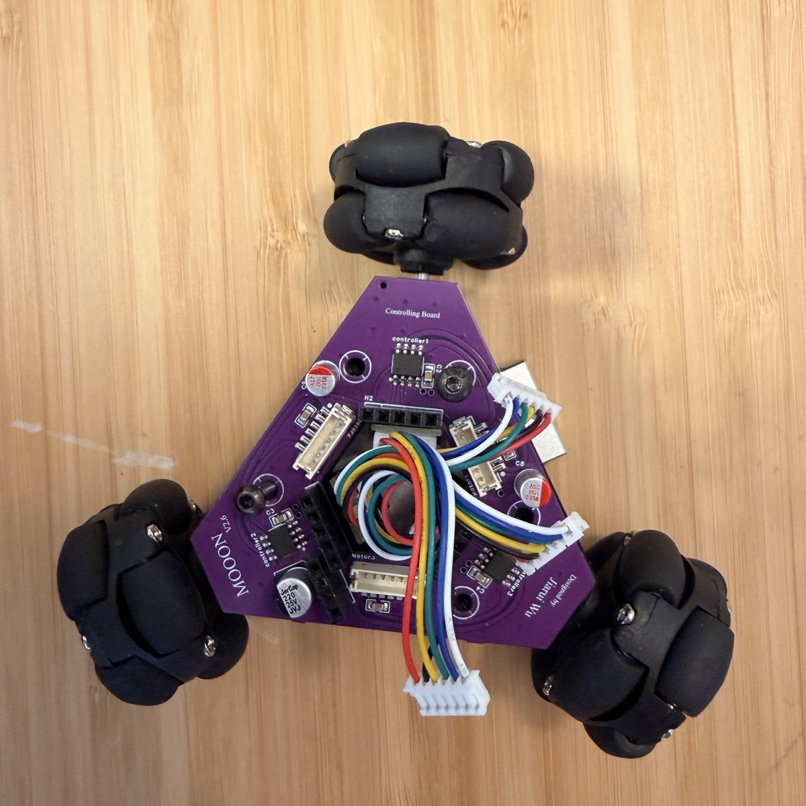
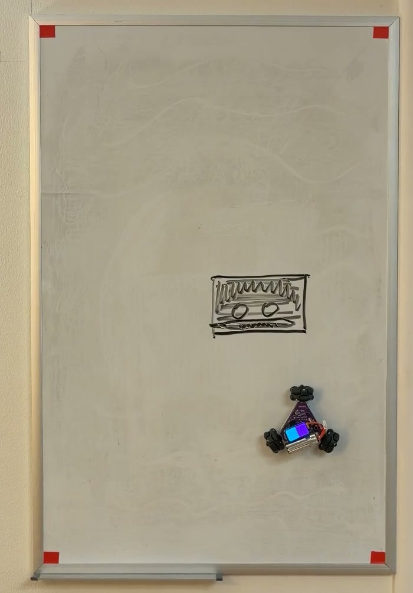
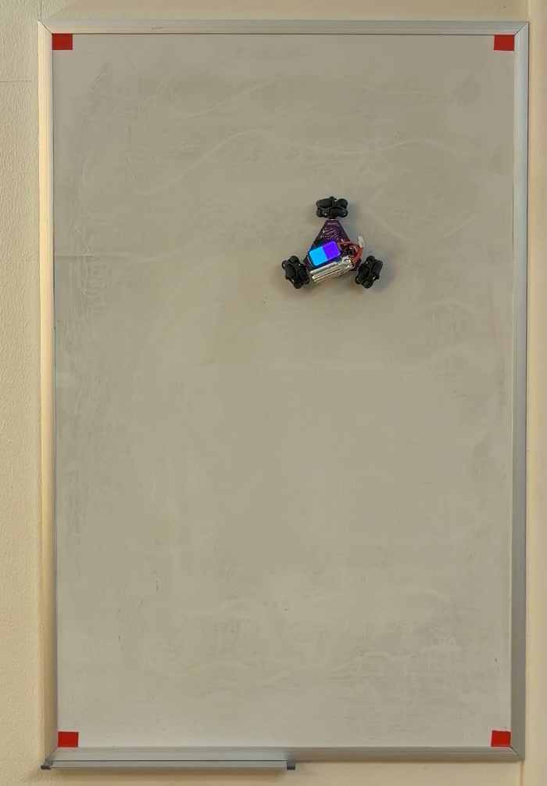
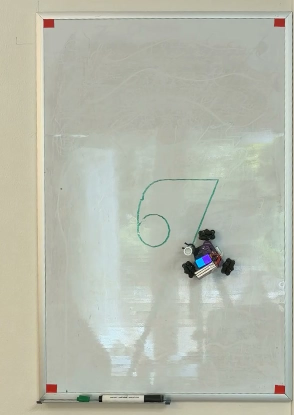

# MOOON: a robot that drives on a vertical whiteboard

MOOON (the project folder is called WhiteBoardBot) is a small robot with three
omni wheels that holds itself to a **vertical magnetic whiteboard** with
magnets. It can hold still against gravity, sweep the whole board in lanes,
find ink with a camera and erase it, and draw with a pen. It runs on circuit
boards I designed and on ESP32-C6 firmware. A phone camera facing the board
measures where the robot really is and sends corrections over Wi-Fi.

<p align="center">
  
</p>

*2026-10-27: the robot from above, on the purple base board (v2.6) that I
designed.*

> This repository keeps the real git history of the project from June 2026
> (when it moved into git) to today, filtered for review: raw logs, videos,
> vendor models and design backups were removed from every commit, and the
> final commit adds my uncommitted work from Oct 28–31, 2026. The Feb–Apr 2026
> work (v1 board, first chassis) appears only as images and netlists. The
> unfiltered repository, with about 1 GB of raw logs and videos, stays private.

## Demo

<p align="center">
  
</p>

*2026-10-26: full-board coverage run on a 35 × 23 in whiteboard (writable
area 33.5 × 21.5 in), 4× speed. Red: path measured by the camera. Blue:
planned area. 13 lanes in 96.6 s; it came back to its start within 0.2 mm.*

| Before erasing | After erasing | Drawing "67" |
|---|---|---|
|  |  |  |
| 2026-10-28 22:35: 130 cm² of ink | 2026-10-28 ≈22:40: board clean | 2026-10-31: one continuous pen line |

Video: the MOOON part of the video in my MIT Maker Portfolio shows the erase
run and the "67" drawing. Raw videos are not stored in this repository.

## How it works

```
 iPhone camera (Continuity Camera) ─> Mac: OpenCV finds 4 red corner tapes
                                     and the robot's LCD beacon
                                          │ position fixes over Wi-Fi
                                          ▼
 ┌────────────────────────── robot ──────────────────────────┐
 │ ESP32-C6-LCD-1.47 module      <- c6_wall firmware          │
 │   └─ adapter PCB (v2, my design)                           │
 │        └─ base PCB (v2.6, my design): 3 H-bridges, 2S LiPo │
 │             └─ 3 N20 gearmotors with encoders,             │
 │                38 mm omni wheels at 120°, magnets          │
 └────────────────────────────────────────────────────────────┘
```

- **Holding on the wall.** Each wheel is a position servo. The integral term
  is never reset, because it holds the torque that keeps the robot up against
  gravity. When idle or after a fault, the motor drivers brake.
  ([`c6_wall/include/wbb_core.h`](c6_wall/include/wbb_core.h))
- **Slip.** The wheels slip on the glossy board, and the encoders cannot see
  that. Camera measurements gave a slip factor for each direction, and the
  firmware corrects its odometry with them.
- **Camera referee.** Four red tapes give the board's corners; the robot's LCD
  shows a cyan/magenta beacon that gives its position and heading. Each fix is
  matched to the robot's odometry history to cancel the camera delay.
  ([`c6_wall/tools/vision.py`](c6_wall/tools/vision.py))
- **Erasing.** The eraser is the felt under the middle magnet. The camera
  finds the ink, the planner covers it with left-right lanes 1.6 cm apart, and
  the robot repeats until nothing is left, then does a fine wipe.
  ([`c6_wall/tools/clean_dirty.py`](c6_wall/tools/clean_dirty.py))
- **Drawing.** The pen cannot lift, so "67" is one continuous path of 30
  points, driven with live camera corrections.
  ([`c6_wall/tools/draw_digits.py`](c6_wall/tools/draw_digits.py))

More detail and the full timeline of what failed and what changed:
[`docs/design-history/`](docs/design-history/),
[`hardware/README.md`](hardware/README.md),
[`c6_wall/README.md`](c6_wall/README.md).

## Build and run

**Hardware needed:** the robot (Waveshare ESP32-C6-LCD-1.47, my adapter v2 and
base v2.6 boards, 3 N20 encoder gearmotors, 38 mm omni wheels, magnets, 2S
LiPo), a magnetic whiteboard with red tape on its four corners, a Mac with an
iPhone as Continuity Camera for the camera tools, and a USB-C cable for the
first flash.

```bash
# PlatformIO needs Python 3.10 or newer (macOS's built-in python3 is 3.9).
# The first build downloads the ESP32 toolchain into ./.platformio
python3.13 -m venv .venv && .venv/bin/pip install platformio
cd c6_wall
../.venv/bin/pio run                  # build the firmware
../.venv/bin/pio run -t upload        # first install over USB
python3 tools/ota.py                  # later updates over Wi-Fi

# desktop simulation test of the control core (no hardware needed)
c++ -std=c++17 -Iinclude tests/sim_test.cpp -o /tmp/sim && /tmp/sim

# camera tools (system python3 with OpenCV)
python3 -m pip install opencv-python numpy
python3 tools/clean_dirty.py scan     # find ink and draw the plan, robot does not move
```

Checked on 2026-11-01 on macOS from this snapshot: `pio run` builds
(`[SUCCESS]`, RAM 22.0 %, flash 45.5 %), and the simulation test prints
`ALL PASSED`. The robot joins Wi-Fi from its own web page; its hotspot
password is random and shown on the LCD (see
[`c6_wall/README.md`](c6_wall/README.md)). No Wi-Fi password is stored in the
source.

The firmware for the next, not-yet-built controller board can also be built
and checked against the board's netlist:

```bash
.venv/bin/pip install -r scripts/requirements-control.txt
.venv/bin/pio run -e top_board_v2_kiss_c6
python3 control_tests/verify_kiss_c6.py   # pins vs EasyEDA netlist, host-side tests
```

## Repository layout

| Path | What it is | State |
|---|---|---|
| [`c6_wall/`](c6_wall) | Current robot firmware, desktop simulation test, camera, erase and drawing tools, [key run logs](c6_wall/results) | **current** |
| [`hardware/`](hardware) | Board designs: `top_board_v2/motor_controller.epro2` (EasyEDA Pro project with the adapter, the base board and the next controller board), netlist exports, the v1 base board netlist, September KiCad sources | current + history |
| [`docs/`](docs) | Design history with dated pictures, demo media, older reports | |
| [`c6_drive/`](c6_drive) | September firmware: Wi-Fi driving, system ID, MuJoCo simulation | archived |
| [`src/`](src), [`include/`](include), [`platformio.ini`](platformio.ini), [`control_tests/`](control_tests), [`scripts/`](scripts) | Spring ESP32 firmware, the August C6 port, firmware and host tests for unbuilt top-board versions, host tools | mostly archived |
| [`c6_selftest/`](c6_selftest), [`testboard_selftest/`](testboard_selftest), [`c6-test/`](c6-test), [`usb_diagnostics/`](usb_diagnostics) | Bring-up and diagnostic firmware | archived |
| [`third_party/`](third_party) | Patched copy of Espressif's ESP-IDF I2C driver (Apache-2.0) | |

Many September notes are in Chinese. Some notes in archived folders link to raw
reports, previews or review files that are only in the full-history
repository.

## Results and limits

What worked on the real robot:
- Holding still on the vertical board, and full-board coverage with camera
  correction (13 lanes in 96.6 s, back to start within 0.2 mm).
- Live camera corrections matter: for 8 cm out-and-back moves at erase speed,
  the average end error was 0.48 cm without corrections and 0.03 cm with them
  (2026-10-28, [`sysid-motion-run.log`](c6_wall/results/sysid-motion-run.log)).
- Autonomous erase (2026-10-28): ink area 130 → 2.31 cm² after pass 1 and
  1.69 cm² after pass 2; after pass 3 and a fine wipe, the final camera check
  found 0 cm² of ink.
  ([`c6_wall/results/`](c6_wall/results))
- Drawing "67" (2026-10-31): 15 cm tall, 30 points; the camera-measured miss
  at each point was 0.17 mm on average and 0.43 mm at most.
- Wi-Fi firmware updates that roll back by themselves if the new image fails.

Honest limits:
- The accuracy depends on the camera. Encoders alone cannot see the wheels
  slip, and without corrections the robot drifts.
- Spinning on the wall caused two power resets and the robot fell both times,
  so erasing while spinning is paused.
- The pen is fixed to the chassis and cannot lift.
- The single integrated controller board (`top_board_v2_logic`: native USB,
  on-board 2S charging, current sensing) is designed but **not built or
  tested**. Its firmware runs only host-side checks, with motion disabled.
- Several earlier top-board designs (September 2026) were dropped for
  complexity or cost and were never ordered.
- All tests were on one 35 × 23 in whiteboard at home.

## Credits

**My work (Jiarui "Jerry" Wu).** The idea and the requirements; the
mechanical design in Onshape; the v1 base board schematic and layout; the
v2.6 base board and the layout of the v2.6 adapter board, and the September
fix of the adapter's M1 header, which had been placed rotated 180°;
assembling, soldering and debugging the robot; running the tests on the real
robot. I proposed using my phone camera as a referee to
measure wheel slip, measured slip by hand, chose the erase approach (find the
dirty spots, plan a path, erase with the felt under the magnet), asked for the
fine wipe, and chose the stroke order for "67". I set the "keep it simple"
rules for the boards and checked the pin assignments before each order.

**Code written by AI tools, from my designs and under my direction; I tested
and tuned it:**
- **Claude Code (Anthropic):** firmware changes in June 2026 (feed-forward,
  stiction); the first draft of the v2.6 adapter board schematic through the
  EasyEDA API in July (I revised it and laid out the board); pre-order design reviews;
  the September self-test firmware; the October wall firmware and tools in
  `c6_wall/` (Wi-Fi updates, coverage planner, camera referee, slip
  identification, erasing, drawing, demo cutting); most of the schematic clean-up,
  routing and checks of the unbuilt `top_board_v2_logic` board in EasyEDA
  from my requirements (Oct 27–30), starting from the Codex KiCad draft
  below; its review firmware and tests (Oct 2026).
- **OpenAI Codex:** the September top-board explorations (KiCad, never built)
  and the September firmware in `c6_drive/` (Wi-Fi driving, web page,
  calibration, system ID, MuJoCo simulation).
- **Cursor:** much of the spring 2026 firmware and test tools.
- **ChatGPT:** help reading error screens and wiring motor drivers in
  February 2026.

**Existing open-source work and parts.** Espressif ESP-IDF I2C driver
(Apache-2.0, patched copy in `third_party/` with its licence); Arduino-ESP32
through the pioarduino PlatformIO platform; ArduinoJson (MIT); Adafruit
ST7735/ST7789 library (MIT); OpenCV; MuJoCo (Apache-2.0) for the September
simulation; EasyEDA Pro and KiCad, with some symbols and footprints from the
EasyEDA/LCSC part library and the `ESP32-C6-MINI-1` footprint copied from the
KiCad footprint library (CC-BY-SA 4.0 with the KiCad library exception); the Waveshare ESP32-C6-LCD-1.47 module (bought).
This is a personal project; no teammates' code is included.

## License

- Software: [MIT](LICENSE).
- Hardware design files in [`hardware/`](hardware): [CERN-OHL-P-2.0](hardware/LICENSE).
- [`third_party/esp_idf_i2c_no_clear`](third_party/esp_idf_i2c_no_clear):
  Apache-2.0 (Espressif).
