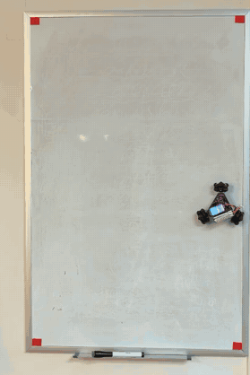

# WhiteBoardBot

A small three-omni-wheel robot that drives on a **vertical magnetic whiteboard**,
holds its position against gravity, and sweeps the whole board in lanes. It runs
on custom PCBs and ESP32-C6 firmware, and a phone camera facing the board
measures its real position.

<p align="center">
  
</p>

*Full-board coverage run on a 33.5 × 21.5 in whiteboard (2026-10-26, shown at 4×
speed, [real-time video](docs/media/coverage-run.mp4)). Red: path measured by
the camera. Blue: planned area. It drove 13 lanes in 96.6 s and returned to its
start within 0.2 mm, with a heading change of −0.18°.*

---

## Status (October 2026)

| Works on the real robot | Designed, not built or tested yet |
|---|---|
| Holding still on a vertical board: each wheel is a position servo with a gravity-holding integral term | `top_board_v2_logic`, the single integrated controller PCB (schematic done, routing in progress) |
| Full-board coverage with live camera correction (above) | On-board 2S USB-C charging (IP2326 just added to the schematic) |
| Wi-Fi firmware updates with automatic rollback | Separate sensor-head board with a gyro, for heading without the camera |
| Measured slip model: open-loop round trips land within 2 mm / 1° in 6 of 8 horizontal trials | Erasing while spinning on the wall (paused: two power resets made the robot fall) |

## How it works

```
 Phone camera (OpenCV) ── live position fixes ──┐
                                                ▼
 ┌──────────────────────── robot ────────────────────────────┐
 │ Waveshare ESP32-C6-LCD-1.47   ← c6_wall firmware          │
 │   └─ custom adapter PCB (v2)                              │
 │        └─ custom base PCB: 3× RZ7889 H-bridge, 2S LiPo    │
 │             └─ 3× N20 gearmotor + encoder, 38 mm omni     │
 │                wheels at 120°, magnets to hold the board  │
 └───────────────────────────────────────────────────────────┘
```

- **Control** ([`c6_wall/include/wbb_core.h`](c6_wall/include/wbb_core.h)).
  - All three wheels track position references derived from one body pose, so
    the chassis drives straight and stopping means holding, not coasting.
  - The integral term is never reset. It keeps the torque that holds the robot
    against gravity, and that load estimate is stored in the world frame.
  - The H-bridges brake (both inputs high) in every idle, fault or reboot state.
- **Slip model.**
  - Encoders only measure the wheels, and the wheels slip on the glossy board.
  - Camera measurements gave the slip per direction: 0.94 going up, 1.13 going
    down, 1.01 sideways.
  - The robot also sags 10.9 cm for every metre it moves sideways.
  - The firmware corrects its odometry with these numbers, which are refit from
    round-trip campaigns.
- **Camera referee** ([`c6_wall/tools/vision.py`](c6_wall/tools/vision.py)).
  - Four red tapes mark the board corners and give a homography.
  - The robot's LCD shows a cyan/magenta beacon, which gives its position and
    heading.
  - Fixes are compensated for latency against a 1.28 s odometry history before
    they are sent to the robot.

## Design iterations

Most of what I learned came from things that did not work. In order:

| When (2026) | What changed | Why / what we measured |
|---|---|---|
| Apr | **v1 base PCB**: ESP32 DevKit socket, 3× RZ7899, XT30 battery ([netlist](hardware/v1_base_board/)) | First robot. Lessons: a GPIO12 strap pin touched by a jumper broke flashing; a shorted driver module can kill the regulator. |
| Jun 16 | ESP32 firmware plus a ROS2 workspace on the host → **ROS2 dropped** | The ESP32 plans and follows paths by itself; a serial console tunes gains live ([report](docs/v1-esp32-report.md)). |
| Jun 16–17 | Per-motor PID, stiction feed-forward, terminal deceleration | Measured breakaway at 100/140/140 PWM. Motor 1's encoder (GPIO36/39) read a phantom 0.58 m/s from PWM crosstalk. Software filters only helped partly; the commit log concludes "hardware fix required". |
| Jul | **ESP32-C6 + LCD module on a custom adapter PCB** | One encoder still never worked. The fabricated panel data showed that the adapter's M1 header footprint was **mirrored**, so PWM drove an encoder output. |
| Aug 12 | Firmware ported to the C6 ([`src/`](src/)) + stall protection | Encoder noise on the new MCU: 0 ghost counts. |
| Sep 5–9 | **Integrated top-board exploration**: R2 (4-layer, 49 parts) → R3 (147 parts) → "KISS" 6V → budget board ([`hardware/top_board_v2`](hardware/top_board_v2)) | Each version got too complex or too expensive. The KISS rules (one motor voltage, reuse the base board, fewer parts) came from that. None of these boards were fabricated. |
| Sep 17 | **Adapter v2** fabricated and brought up ([`c6_selftest`](c6_selftest)) | All three motor slots pass in both directions with 0–1 invalid quadrature transitions. |
| Sep 21 – Oct 4 | [`c6_drive`](c6_drive): Wi-Fi driving, system ID, MuJoCo simulation, 19 controller revisions | Simulation halved position error on the holdout set (9.4 → 4.4 mm), but on the real wall **the robot slid down**: encoders cannot see the chassis slip. Motion also still felt jerky. A TF card in the LCD board turned out to share GPIO4/5 with motor 2 and made it run away at PWM 0. |
| Oct 24–27 | Rewrite as [`c6_wall`](c6_wall): position servos, braking, OTA, camera referee | The camera showed the inherited wheel radius was wrong in both size and sign (+33.7 mm → −50.4 mm). Fixed gearbox chatter (kd too high) and one stiff gearbox (breakaway ramp: settling 3.8 s → 0.09 s). Coverage run above. |
| Oct 27–28 | **`top_board_v2_logic`** in EasyEDA: one A3 schematic, sensor head split off, GPIO remap, curved routing, on-board charger | In progress. Each step is a commit of [`motor_controller.epro2`](hardware/top_board_v2/motor_controller.epro2); see `git log -- hardware/top_board_v2/motor_controller.epro2`. |

## Repository map

| Path | What it is | State |
|---|---|---|
| [`c6_wall/`](c6_wall) | Current robot firmware, desktop simulation test, camera and calibration tools | **current** |
| [`hardware/top_board_v2/`](hardware/top_board_v2) | Top-board designs (KiCad + EasyEDA), reviews, simulations; `motor_controller.epro2` is the current EasyEDA project | current design + history |
| [`c6_drive/`](c6_drive) | Previous firmware: Wi-Fi driving, system ID, MuJoCo sim, controller study | archived |
| [`c6_selftest/`](c6_selftest), [`testboard_selftest/`](testboard_selftest), [`c6-test/`](c6-test), [`usb_diagnostics/`](usb_diagnostics) | Bring-up and diagnostic firmware | archived |
| [`src/`](src/), [`include/`](include/), [`test/`](test/), [`platformio.ini`](platformio.ini) | v1 ESP32 firmware, the August C6 port, and firmware variants for the unbuilt top boards | archived |
| [`control_tests/`](control_tests), [`docs/`](docs) | Host tests and notes for the top-board firmware variants | archived |
| [`scripts/`](scripts) | Host tools: PID tuner, sysid and campaign analysis | mixed |

Many notes from September are in Chinese. Raw experiment logs (about 1 GB of
JSON and video) are kept offline.

## Build and run (current firmware)

```bash
python3 -m venv .venv && .venv/bin/pip install platformio
cd c6_wall
../.venv/bin/pio run -t upload        # first install over USB
python3 tools/ota.py                  # later updates over Wi-Fi
c++ -std=c++17 -Iinclude tests/sim_test.cpp -o /tmp/sim && /tmp/sim   # desktop test
```

See [`c6_wall/README.md`](c6_wall/README.md) for the web interface, Wi-Fi
setup and the camera tools.

## How this was built

I designed the PCBs, assembled and debugged the robot, ran the experiments and
set the goals and constraints. Much of the firmware, analysis scripts and
PCB-automation code was written with AI coding assistants (Claude Code and
OpenAI Codex) working under my direction. Commits made with Claude carry a
`Co-Authored-By` line.

The Aug 28 – Oct 28 history was committed when the project was published, so
those commits were rebuilt from file timestamps and EasyEDA backups. Each of
them says so in its message.

## License

- Software: [MIT](LICENSE).
- Hardware design files in [`hardware/`](hardware): [CERN-OHL-P-2.0](hardware/LICENSE).
- [`third_party/esp_idf_i2c_no_clear`](third_party/esp_idf_i2c_no_clear) is a
  patched copy of Espressif's ESP-IDF I2C driver, under Apache-2.0.
