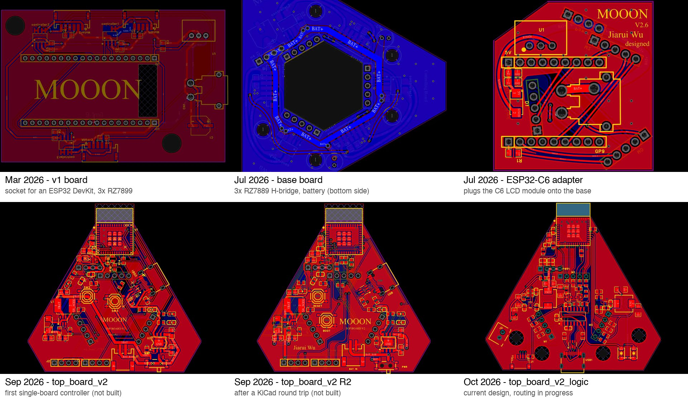
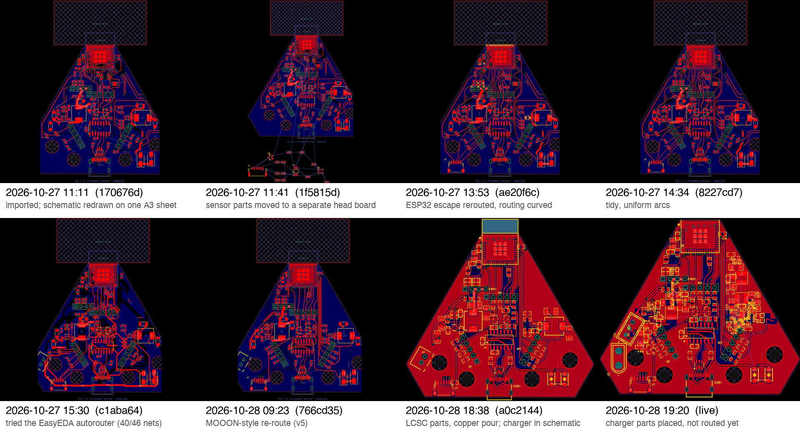
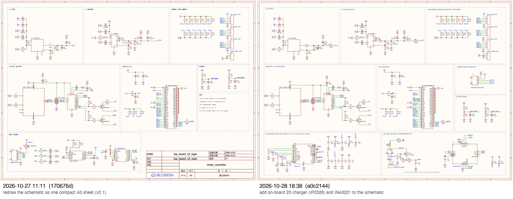

# Design history

This page shows how the robot's circuit boards changed over time, with
evidence for each date.

## Where the images come from

- **EasyEDA previews.** EasyEDA Pro saves a preview of every schematic and PCB
  inside the project file each time the project is saved. Most images on this
  page are those previews, taken from
  [`hardware/top_board_v2/motor_controller.epro2`](../../hardware/top_board_v2/motor_controller.epro2).
  No image here was redrawn by hand.
- **Reproducible.** [`make_figures.py`](make_figures.py) rebuilds every figure
  directly from the git history of that file:

  ```bash
  python3 docs/design-history/make_figures.py   # needs Pillow
  ```

- **Live capture.** `logic-pcb-live-2026-10-28.png` was captured from the
  running EasyEDA editor on 2026-10-28 through the EasyEDA API.

Dates come from three sources. Each caption says which one it uses:

1. **Schematic title blocks.** EasyEDA fills in the creation and update dates
   automatically.
2. **Commit timestamps** of the project file.
3. **The EasyEDA backup file names**, which carry the save time.

The October commits were added to git on 2026-10-28 from those timestamped
backups (see the [main README](../../README.md#how-this-was-built)).

## Board generations



| Board | Dates (from the title block) | Notes |
|---|---|---|
| v1 board | created 2026-03-09 | Socket for a 38-pin ESP32 DevKit and three RZ7899 drivers. Motor 1's encoder pins (GPIO36/39) picked up PWM noise, which led to the next generation. [Schematic](v1-schematic.jpg), [netlist](../../hardware/v1_base_board/). |
| base board (`bottom_board`) | created 2026-07-01 | Triangular base with three RZ7889 H-bridges and the battery input. Still in use. |
| ESP32-C6 adapter (`top_board`) | created 2026-07-02, updated 2026-07-03 | Carries the Waveshare ESP32-C6-LCD module. The first fabricated adapter had the M1 header footprint mirrored. The respin was brought up on 2026-09-17 and is in use now. |
| `top_board_v2`, R2 | September 2026 | First attempts at one integrated controller board. Never fabricated. |
| `top_board_v2_logic` | 2026-10-27 → | Current design: ESP32-C6-MINI-1, CH343G USB, 3.3 V and 6 V supplies, and on-board 2S charging. |

The September directions that were explored in KiCad and dropped are covered
in [`hardware/README.md`](../../hardware/README.md#earlier-top-board-directions-not-fabricated):

| Direction | Image |
|---|---|
| R2, 4-layer | [image](../../hardware/top_board_v2/validation/kicad_top.png) |
| "KISS" 6V module carrier | [image](../../hardware/top_board_v2/kiss_6v/electrical_layout/carrier_preview.png) |
| Module-fit study | [image](../../hardware/top_board_v2/kiss_6v/module_fit.png) |
| Low-cost placement | [image](../../hardware/top_board_v2/jlc_budget_6v/controller_core/logic/preview/placement.png) |

## `top_board_v2_logic`, step by step (2026-10-27 → 2026-10-28)



Each frame is the PCB preview stored in the project file at that commit. The
last frame is the live editor. To see the full message for any frame, run:

```bash
git show <hash> --stat
```

Steps worth noting:

- **11:41, sensor head split off.** The IMU, ADC and IR emitter moved off the
  board, so their parts sit outside the outline, waiting for their own board.
- **13:53 → 14:34, curved routing.** All routing was converted to tangent
  arcs.
- **15:30, autorouter test.** EasyEDA's autorouter was tried; it completed 40
  of 46 nets and was not kept.
- **28 Oct, final steps.** A MOOON-style re-route, then a swap to LCSC-stocked
  parts with 3D models, then a copper pour. The 2S charger went into the
  schematic and is being placed now.

## Schematic: before and after



**Left (2026-10-27):** the first compact A3 sheet. Notes are in Chinese and it
still includes the IMU/ADC sensor block.

**Right (2026-10-28):** notes translated to English. The sensor block is
replaced by:
- the 2S USB-C charger (IP2326_NPD, 8.3 V, 0.75 A, with balancing);
- the battery/balance tap;
- the INA3221 current monitor.
